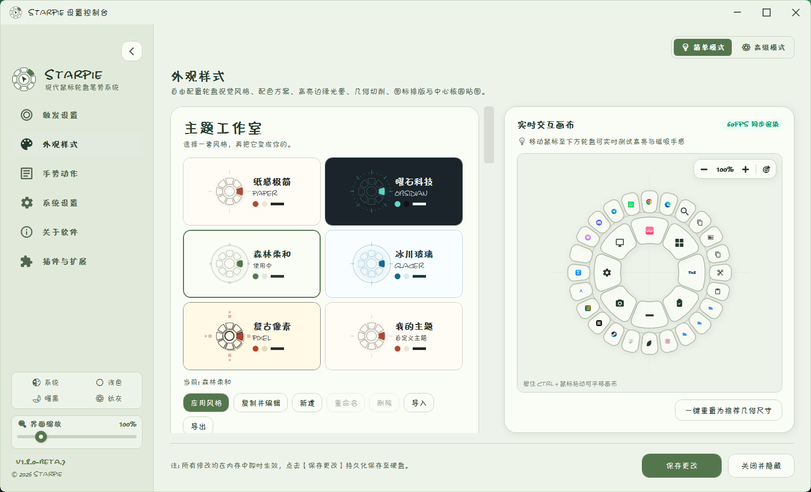
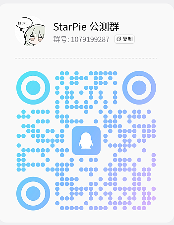

<div align="center">


# StarPie (星盘)

### 轻量、快捷的 Windows 鼠标轮盘手势与效率工具

**Lightweight, Fast & Configurable Radial Pie Menu for Windows 10 / 11**

[](https://github.com/Star-Pie/StarPie/releases)
[-0078D4.svg?style=flat-square&logo=windows)](https://microsoft.com/windows)
[](https://dotnet.microsoft.com/)
[](LICENSE)
[](tests/)
[](#i18n)
[](https://github.com/Star-Pie/StarPie/releases)
[](https://github.com/Star-Pie/StarPie-Official-Plugins)
[](https://qm.qq.com/q/y1J4gxkUTu)
[](https://star-pie.github.io/)
[](https://star-pie.github.io/sponsor/)

<br/>

**项目仓库：[GitHub](https://github.com/Star-Pie/StarPie) · [AtomGit](https://atomgit.com/Star-Pie/StarPie)**

**[简体中文](README.md)** • **[English](README_EN.md)**

<br/>

[🌟 功能概览](#highlights) • [✨ 功能特性](#features) • [🎨 外观定制](#visuals) • [🌐 多语言](#i18n) • [🧩 插件与主题](#extensions) • [🚀 快速开始](#download) • [🛠️ 本地构建](#build)

[📌 项目状态](#project-status) • [💬 社区交流](#community) • [🤝 参与贡献](#contributing) • [🙏 特别鸣谢](#special-thanks) • [❤️ 支持与致谢](#support) • [⭐ Star 历史](#star-history) • [📋 更新日志](CHANGELOG.md)

</div>

---

<a id="intro"></a>

## 📖 简介

**StarPie (星盘)** 是一款专为 Windows 10 / 11 打造的轻量级鼠标轮盘手势（Radial / Pie Menu）效率工具。

> [!NOTE]
> **正式版：v2.0.0（2026-10-17）**。[插件系统](#plugins) 与[主题工作室](#theme-studio)已纳入正式版。功能、升级与下载说明以 [v2.0.0 Release](https://github.com/Star-Pie/StarPie/releases/tag/v2.0.0) 为准。

在日常使用中可通过**鼠标右键 / 中键 / 侧键或键盘触发键**呼出快捷轮盘，也可使用独立的轨迹手势直接执行动作。v2.0.0 正式版支持 4 / 8 / 12 方位轮盘、多级子动作、专属程序配置（Per-App Profiles）、快捷键录制与主题工作室，并通过独立安装的官方插件提供程序、网址、命令、窗口管理与屏幕 OCR 等能力，帮助将高频操作转化为自然的肌肉记忆。

> 💡 **设计重点**：
> - **低资源占用**：基于原生 C# WPF 构建，无浏览器内核打包，后台常驻内存以轻量化为目标，静默后台工作集目标为 **15 ～ 30 MB**（实际占用随环境与使用情况变化）；
> - **低延迟响应**：基于 Win32 `WH_MOUSE_LL` 底层事件流，响应迅速，不影响鼠标正常右键点击；
> - **绿色便携**：提供独立单文件版（内置 .NET 运行时，解压即用），配置保存于本地 `config.json`；

---

<a id="demo"></a>

## 🎬 演示视频

<div align="center">

[](https://www.bilibili.com/video/BV1cubL6WEpB)

</div>

<details open>
<summary><b>🎬 演示视频 / Video Demo </b></summary>
<br/>

<div align="center">
  <a href="https://www.bilibili.com/video/BV1XjtA6KEGL" target="_blank">
    
  </a>
  <p>
    <a href="https://www.bilibili.com/video/BV1XjtA6KEGL"><b>📺 点击前往 Bilibili 观看原声讲解与实机演示</b></a>
  </p>
</div>
</details>

---

<a id="highlights"></a>

## 🌟 v2.0.0 正式版功能概览

StarPie **v2.0.0** 汇总 v1.7.4 之后的改进，结束 v1.8.0 Beta 开发线，重点带来 **独立插件体系、主题工作室、级联动作编辑与撤销/重做、统一轮盘交互事件、独立音效插件，以及配置与运行稳定性改进**。官方插件按需下载安装，不随主程序发行包附带。

| 功能方向 | 当前能力 |
| :--- | :--- |
| **轮盘交互** | 4 / 8 / 12 扇区、中心核圆动作、多级子轮盘、蜂窝扇与外甩取消 |
| **轨迹手势** | 最多 3 段、8 方向组合、轨迹浮层、分段灵敏度与释放提示 |
| **动作与窗口** | 快捷键、程序、网址、文件夹、命令、系统控制，以及窗口切换、平铺、跨屏、置顶与透明度 |
| **屏幕 OCR** | Windows 本地离线识别、AI 视觉接口与自定义 HTTP OCR |
| **配置体验** | 双栏聚焦编辑、实时轮盘画布、级联动作编辑、复制粘贴、列表排序与撤销 / 重做 |
| **外观定制** | 多种轮盘形态、独立一二级主题、单扇区覆盖，以及五套主题工作室风格与主题导入 / 导出 |
| **原生极速搜索** | 不再依赖 Everything；应用预索引、分类过滤、搜索按钮与键盘操作 |
| **插件扩展** | 统一安装确认、能力说明、参数校验、按需加载与预加载；官方插件独立安装 |
| **交互音效** | 由独立音效插件提供事件音效、本地 WAV 与方案导入 / 导出；需单独安装并启用 |
| **安装与升级** | Setup 安装版、Standalone 独立便携版与 Lightweight 轻量版 |

> 📋 更完整的版本变化请查看 [CHANGELOG.md](CHANGELOG.md)。

---

<a id="features"></a>

## ✨ 功能特性

### 1. ⚡ 鼠标手势快速呼出与动作触发

- 按住鼠标右键滑动超过设定阈值即呼出轮盘，滑向目标扇区后松开按键即可触发对应动作（热键、打开程序、打开文件夹或系统功能）；
- 普通右键单击依然正常弹出原生右键菜单，互不冲突；
- 支持右键、中键、侧键、键盘单键与组合修饰键作为触发键，并可选择拖动越阈值或长按延时呼出；
- 录制快捷键时可临时独占并暂停全局热键，避免 `Win + D`、`Alt + Tab` 等系统组合被意外执行。

<div align="center">
  
  <br/><br/>
  
</div>

---

### 2. 🌟 多级级联子轮盘

- **多级轮盘级联交互**：支持在任意扇区方位自由扩展 1~4 个二级子动作。光标划向扇区并在扇区内停留时，外环以弹性动画平滑展开二级子扇区，向外滑入即可极速触发。
- **一二级主题与配色完全独立定制**：支持单独调节各级尺寸、字号与图标排版；二级轮盘既可**一键同步主轮盘**，也可**完全独立定制专属风格与配色**；
- 支持外圈子环与蜂窝扇两种二级形态，加入迟滞保持和防抖判定，降低边界移动时的闪烁与误收起；
- 一级与二级动作均支持拖拽对调，并可选择拖动一级动作时是否同步交换其二级子动作。

<div align="center">
  
  <br/><br/>
  
</div>

---
### 3. 🚀 顺势外甩脱离取消 (Outer Escape Cancel)

- 若划出手势后不想执行任何动作，无需反向拉回中心核圆；
- 只需顺势向外快速滑动脱离轮盘边缘，轮盘自动进入半透明安全取消状态，松开右键不触发任何动作；
- 支持在设置中开启/关闭，并可通过滑块微调外甩距离灵敏度（140px ~ 320px）；还可为外甩取消配置独立动作与常用预设，中心核圆取消仍可保持静默。

<div align="center">
  
</div>

---

<a id="visuals"></a>

### 4. 🎨 多种轮盘形态与风格预设
- **4 种几何形态**：经典紧凑扇区 (Original)、独立悬浮圆形 (Circle)、圆角胶囊 (Capsule)、蜂巢六边形 (HexagonHive)；
- **多套预设主题**：跟随系统、浅色模式、深色模式、液态毛玻璃、抹茶森林、冰川透蓝、莫兰迪柔灰；
- 右侧提供 **实时交互预览画布**，支持缩放、平移、复位、点击选中与拖拽换位，调节参数即时可见；同时提供屏幕边缘防溢出策略与 X / Y 安全边距。

<div align="center">
  
  <br/><br/>
  
</div>


---

### 5. 🎯 4 / 8 / 12 扇区方位自适应
- **4 键方位**：上下左右大角度，适合盲操；
- **8 键方位**：经典 8 向均衡布局（默认）；
- **12 键方位**：高密度功能映射，适合多动作工作流；中心核圆也可配置独立动作，并支持唤醒死区灵敏度。

<div align="center">
  
</div>

---

### 6. 💼 多程序专属配置方案

- 支持针对 Chrome、VS Code、Photoshop、SolidWorks 等不同前台程序分别设置专属轮盘配置；
- StarPie 会根据当前活动程序自动匹配对应方案，没有专属方案时回退到全局配置；
- 支持配置方案的新建、复制、删除与一键重命名，方便复用和维护不同工作流。
- **方案继承规则**：新建专属方案默认关闭「继承全局方案未配置槽位」；按需开启后，第 N 层优先继承全局第 N 层，超出全局层数的部分回退到全局第 1 层。
- 中心核圆动作随当前活跃层同步，切层时同步更新外圈子轮盘与高亮状态。

<div align="center">
  
</div>

---

### 7. 🎛️ 动作配置工作区、应用快捷录入与拖拽编辑

- 动作页采用“配置方案 + 聚焦编辑卡片 + 实时轮盘画布”的双栏工作区，也保留适合快速查看多个动作的紧凑全览列表；
- 提供智能应用选择器，可汇总已安装程序，并支持名称搜索与快速过滤；
- 提供运行窗口捕捉器，可直接选择当前桌面上的窗口或进程，减少手动查找可执行文件路径；
- 可直接点击画布选择目标扇区，并拖拽交换一级扇区、二级动作和中心核圆的位置；
- 中心核圆可启用独立动作，支持死区松开触发、常用预设及独立文字和图标排版；
- 每个扇区可独立覆盖布局模式、字体、字号、文字颜色、图标大小、文字位置及 X / Y 偏移。

<div align="center">
   
    <br/><br/>
  
</div>
---

<a id="i18n"></a>

### 8. 🛡️ 场景隔离、全屏防误触与多语言

- **全屏与游戏检测**：运行全屏独占应用或游戏时自动放行原生右键；
- **修饰键穿透**：支持按住 Ctrl / Shift / Alt 时绕过轮盘；
- **黑名单支持**：支持将指定进程加入排除名单；
- **多语言热切换**：内置简体中文、繁体中文、English、日本語，切换即时生效；`ScreenHelper` 统一处理多显示器、混合 DPI 与屏幕边缘坐标，减少副屏唤起漂移和轮盘溢出。

<div align="center">
  
  <br/><br/>
  
</div>

---

### 9. ➡️ 独立轨迹手势与可视化提示

- 可为轨迹手势单独指定右键、中键或侧键，与轮盘触发键并行使用；
- 支持最多 3 段、8 方向的轨迹组合，通过短段过滤和相邻同向合并减少快速绘制时的微小抖动误判；
- 绘制时显示透明轨迹浮层、起点和释放提示，可调节分段灵敏度及提示文字方位；
- 未达到拖动阈值的轻点会回放为原生鼠标点击，不影响日常操作。

<div align="center">

</div>

---

### 10. 🧰 更完整的动作类型体系

| 动作分类 | 主要用途 |
| :--- | :--- |
| **快捷热键** | 录制或拼装组合键，支持主按键搜索、Pause / Break 与独占录入 |
| **启动程序** | 启动 EXE、快捷方式或文件，可携带参数并选择常规权限启动 |
| **打开网址** | 使用系统默认、Chrome、Edge、Firefox 或自定义浏览器打开网址 |
| **打开文件夹** | 打开本地路径及桌面、下载等系统虚拟目录 |
| **运行命令** | 支持 CMD、PowerShell、WSL 及隐藏终端模式 |
| **屏幕 OCR** | 框选屏幕区域并调用本地、AI 或自定义 HTTP 识别 |
| **窗口管理** | 切换窗口、平铺、跨屏移动、置顶与透明度控制 |
| **系统控制** | 锁屏、音量、媒体、任务视图、虚拟桌面等系统功能 |

除内建快捷键外，上述程序、网址、文件夹、命令、OCR、窗口管理与系统控制等能力由对应官方插件提供，需要在「插件与扩展」中单独安装并启用。动作执行与显示图标已经解耦，同一动作可独立选择内置矢量图标、程序图标或自定义图片，不再被动作类型限制。

---

<a id="extensions"></a>
<a id="beta"></a>

## 🧩 v2.0.0 关键变动

插件系统与主题工作室已随 v2.0.0 正式发布；原 v1.8.0 Beta 开发线的功能与改进已汇总到本版。

<a id="plugins"></a>

### 🧩 插件系统

> [!IMPORTANT]
> **原有多项内置动作已迁入官方插件，升级后需单独安装并启用所需模块**；主程序发行包不附带官方插件。

StarPie 使用轻量的 **.NET 进程内 DLL 插件架构**。插件只需引用独立的
`StarPie.Plugin.Abstractions` 契约程序集，通过 `Initialize` 注册动作等贡献；主程序则为每个插件创建
宿主包装实例，统一管理扫描、加载、惰性激活、调用租约、异常隔离、异步停用和程序集卸载。

动作执行路径覆盖从注册、配置、参数校验到 Sequential / Background 调度的完整闭环；
交互事件与轮盘结构路径也已建立可扩展入口，后续可以继续扩展而不复制整套插件生命周期代码。

> 📖 **插件开发入口**：开发文档、当前 API、架构说明、示例工程和历史资料统一收录在 [《StarPie 插件开发资源》](plugin/README.md)。
> 🔗 **官方插件仓库**：[StarPie-Official-Plugins](https://github.com/Star-Pie/StarPie-Official-Plugins)。主仓库中的 `plugin/StarPie-Official-Plugins/` 是该仓库的 Git 子模块检出目录；官方插件的源码、打包和发布流程均在这个独立仓库中维护，StarPie 主仓库不重复引用、构建或随发行包携带官方插件 DLL。

- **官方插件手动安装与首次引导**：
  - **发行包零预置**：StarPie 发行包不随包携带官方插件 DLL，启动与后台运行保持零自动网络请求。
  - **一次性引导知情同意例外**：为了提升新用户上手体验，用户首次交互式打开设置窗口时（非静默启动、非自检模式，且插件系统正常开启），会弹出一次性知情引导弹窗。弹窗展示 5 项核心官方插件（`folder`, `weburl`, `launch`, `system`, `shelltool`）、官方仓库来源及所需权限（`Process` 启动进程、`InputSimulation` 按键模拟）。
  - **零网络请求原则**：用户点击“一键安装”前，宿主绝对不发起任何网络请求（不拉取 catalog、不下载包）；用户点击“一键安装”后，仅下载安装缺失项；已安装项跳过（不覆盖、不升级、保留禁用状态）；若官方目录中包含超出预告范围的权限，暂停并请求用户确认。
  - **常驻重试入口**：若用户选择“暂不安装”或部分项下载失败，在「插件与扩展」页面顶部常驻提供一键重试/安装横幅，已成功项保留，随时可补全缺失项。
- **社区插件仍可本地安装**：把社区插件 `.dll` 放进**程序目录的 `plugin` 文件夹**后点「重新扫描」，在候选卡片上点安装；或在设置里点「手动安装社区插件 (.dll)」直接挑文件。
- **⚠️ 放进 `plugin\` 只会用那一枚 `.dll`**：插件包里的其它文件（图标、资源、依赖 dll）
  不会被一起复制过去。需要**整包安装**时请改用「手动安装社区插件 (.dll)」，选中插件包目录里带
  `plugin.json` 的那一枚 —— 识别到清单后宿主会整目录复制。
- **两个目录职责分开，互不干扰**：

  | 目录 | 角色 |
  | :--- | :--- |
  | `<程序目录>\plugin\` | **社区插件候选区**：仅用于手动安装社区 `.dll`；StarPie **只读不写**，不会在这里创建任何文件 |
  | `%LOCALAPPDATA%\StarPie\plugin-data\` | **可写数据目录**：安装副本、启用状态、插件私有数据都在这里，卸载时整目录清除 |

- **安装与启用分离**：装完默认是「已安装但未启用」，必须手动勾选才会加载 ——
  避免「放一份文件进去」等价于「放行它的代码」。安装前会展示 ID、版本、作者、目标框架、
  架构、SHA256、签名状态与声明的能力清单。
- **候选卡片会直接告诉你结论**：可安装 / 有新版本 / 版本更旧 / 已装同版本 / 内容已变 /
  ID 重复 / 无法识别。同一 ID 出现两份文件时两份都会被标成「ID 重复」且不给安装按钮。
- **失败自保护**：单个插件加载失败或连续触发异常会被隔离，不影响 StarPie 本体；
  连续两次启动异常会进入安全模式并临时禁用可疑插件。
- **给插件作者**：先阅读 [插件开发资源](plugin/README.md) 中的快速入门和当前源码入口。历史 `plugin/samples/` 模板不在当前 checkout，不能照旧路径构建；`FloatingBall` 当前源码位于官方插件子模块。调试时可用
  `StarPie.exe --plugin-selftest <插件.dll> [报告路径] --skip-invoke` 在临时沙箱里跑
  全链路自检（不会碰你已装好的插件），或用 `StarPie.exe --plugin-paths` 查看当前生效的目录。


<a id="theme-studio"></a>
<a id="art-style-beta"></a>

### 🎨 主题工作室

> [!IMPORTANT]
> 主题工作室可与既有轮盘形态及独立配色一起使用，详见 [外观定制](#visuals)。

「外观样式 → 主题工作室」提供纸感极简、曜石科技、森林柔和、冰川玻璃、复古像素五套风格，可复制编辑配色、字体、圆角与轮盘材质，支持即时预览和主题文件导入／导出。

<div align="center">
  
</div>

 查看 [主题工作室说明](docs/art-style-themes.md) 或 [可导入示例](themes/)。旧配置和独立轮盘配色继续保留。

---

<a id="download"></a>

## 🚀 快速开始与下载

**当前正式版：[v2.0.0](https://github.com/Star-Pie/StarPie/releases/tag/v2.0.0)（2026-10-17）**。安装版和独立便携版内置 .NET 8；轻量版需要目标电脑已安装 .NET 8 Desktop Runtime x64。

> [!WARNING]
> **v2.0.0 的三个发行包均未签名**，正式 CA 证书仍在办理，Windows 可能显示「未知发布者」。请仅从官方 Release 下载并核对同页的 `SHA256SUMS.txt`；本版未使用测试证书发行。

| 版本包 | 适用场景 | 说明 | 下载入口 |
| :--- | :--- | :--- | :--- |
| **Setup 安装版** | 安装向导、卸载与版本升级 | 内置 .NET，安装时检测运行中的 StarPie | [下载 Setup](https://github.com/Star-Pie/StarPie/releases/download/v2.0.0/StarPie-v2.0.0-Setup-win-x64.exe) |
| **Standalone 独立便携版** | 无需安装，解压即用 | 内置 .NET 运行时 | [下载 Standalone](https://github.com/Star-Pie/StarPie/releases/download/v2.0.0/StarPie-v2.0.0-Standalone-win-x64.zip) |
| **Lightweight 轻量便携版** | 已安装 .NET 8 Desktop Runtime | 不携带 .NET 运行时 | [下载 Lightweight](https://github.com/Star-Pie/StarPie/releases/download/v2.0.0/StarPie-v2.0.0-Lightweight-win-x64.zip) |
| **历史版本与预发布** | 回溯旧版本或查看预发布 | v1.8.0 Beta 为历史开发线，当前正式版为 v2.0.0 | [浏览 Releases](https://github.com/Star-Pie/StarPie/releases) |

升级前请备份配置和插件数据。从 v1.7.4 升级后，请在「插件与扩展」安装并启用所需官方模块；缺少模块时保留动作数据，但对应动作暂不可用。交互音效需要独立音效插件，不再由宿主内置播放；请检查已有方案、插件启用与预加载偏好。显式限制最高宿主版本的旧插件可能需要作者更新兼容声明。

### 基础使用流程：
1. 下载并运行 `StarPie.exe`，程序会在系统托盘中后台运行；
2. 双击托盘图标打开设置窗口，在「触发设置」中录制轮盘触发键；
3. 按需在「插件与扩展」安装并启用所需官方插件，再配置相应动作；
4. 按住触发键拖动超过阈值，或按配置长按，即可在光标附近唤出轮盘；
5. 滑至目标扇区后松开触发键执行动作，向外甩出则可取消或执行自定义取消动作；
6. 如需轨迹手势，可启用独立手势触发键，并在动作页映射 1～3 段方向组合。

---

<a id="build"></a>

## 🛠️ 本地构建与开发

以下命令检出 **v2.0.0 正式版标签**。如需参与后续开发，克隆默认 `main` 分支并参阅 [插件文档](plugin/README.md)；主线源码可能领先于正式发布。

### 环境要求

- Windows 10 / 11 (x64)
- [.NET 8.0 SDK](https://dotnet.microsoft.com/download/dotnet/8.0)
- Python 3.10+ (仅运行自动化测试套件需要)

### 编译与运行

```bash
# 1. 克隆代码仓库
git clone --branch v2.0.0 https://github.com/Star-Pie/StarPie.git
cd StarPie

# 2. 编译项目 (Release)
dotnet build WinPieGestures/WinPieGestures.csproj -c Release

# 3. 运行项目
dotnet run --project WinPieGestures/WinPieGestures.csproj

# 4. 发布轻量版（需要目标电脑安装 .NET 8 Desktop Runtime）
dotnet publish WinPieGestures/WinPieGestures.csproj -c Release -r win-x64 --no-self-contained -o releases/local/Lightweight

# 5. 发布独立版（自带 .NET 运行时）
dotnet publish WinPieGestures/WinPieGestures.csproj -c Release -r win-x64 --self-contained true -p:PublishSingleFile=true -p:IncludeNativeLibrariesForSelfExtract=true -o releases/local/Standalone
```

---

<a id="project-status"></a>

## 📌 项目状态 (Project Status)


- **正式版**：[v2.0.0](https://github.com/Star-Pie/StarPie/releases/tag/v2.0.0)，发布于 2026-10-17。
- **版本沿革**：原计划的 v1.8.0 正式版因改动规模升级为 v2.0.0，结束 v1.8.0 Beta 系列；插件系统与主题工作室已正式发布。版本记录见 [Releases](https://github.com/Star-Pie/StarPie/releases) 和 [CHANGELOG.md](CHANGELOG.md)。

### Windows 代码签名支持

<table>
  <tbody>
    <tr>
      <td align="center">
        
      </td>
      <td>
        Windows 免费代码签名由 <a href="https://signpath.io">SignPath.io</a> 提供，证书由 <a href="https://signpath.org/">SignPath Foundation</a> 提供。
      </td>
    </tr>
  </tbody>
</table>

---

<a id="community"></a>

## 💬 社区交流 (Community)

<table>
  <thead>
    <tr>
      <th>QQ 公测群</th>
    </tr>
  </thead>
  <tbody>
    <tr>
      <td align="center">
        
      </td>
    </tr>
  </tbody>
</table>

欢迎使用 QQ 扫描二维码或点击链接加入 [](https://qm.qq.com/q/y1J4gxkUTu)

也可通过邮箱联系开发者：[](mailto:erisnebula09@gmail.com) [](mailto:ztzastra@gmail.com)

也欢迎在 GitHub 中与我们交流：

| 入口 | 用途 |
| --- | --- |
| [GitHub Discussions](https://github.com/Star-Pie/StarPie/discussions) | 交流使用经验、分享主题与工作流、讨论功能想法 |
| [GitHub Issues](https://github.com/Star-Pie/StarPie/issues) | 提交 Bug、兼容性问题和明确的功能需求 |
| [Pull Requests](https://github.com/Star-Pie/StarPie/pulls) | 提交或讨论代码、文档与翻译改进 |

请保持友善、尊重与耐心，尽量提供可复现的信息；不要公开密码、API Key 或含隐私的配置文件。

---

<a id="contributing"></a>

## 🤝 参与贡献 (Contributing)

欢迎提交代码、文档与翻译改进，也欢迎提供主题、演示素材和兼容性反馈。开始前请阅读 [贡献指南](CONTRIBUTING.md)；插件开发请参阅 [插件开发文档](plugin/README.md)。

- **反馈问题**：先搜索 [已有 Issues](https://github.com/Star-Pie/StarPie/issues)，再附上 StarPie 版本、Windows 版本、复现步骤与必要的截图或日志。分享日志前请移除隐私信息。
- **讨论方案**：涉及交互行为、配置兼容或插件契约的改动，建议先在 Issue 或 [Discussions](https://github.com/Star-Pie/StarPie/discussions) 中沟通。
- **提交改进**：通过 [Pull Request](https://github.com/Star-Pie/StarPie/pulls) 说明改动目的、验证结果与尚未验证的部分；视觉效果和真实系统交互仍需实机验收。

感谢所有 [项目贡献者](https://github.com/Star-Pie/StarPie/graphs/contributors) 的参与！

<a id="special-thanks"></a>

### 🙏 贡献者致谢

> [!TIP]
> StarPie 的每一步改进都离不开开源社区。感谢每一位贡献代码、反馈问题、参与测试、完善翻译和分享主题的朋友，你们让这个项目变得更好。

<a href="https://github.com/Star-Pie/StarPie/graphs/contributors">
  
</a>

---

<a id="support"></a>

## ❤️ 支持与致谢 (Support & Thanks)

感谢每一位支持 StarPie 的朋友。你的支持帮助我们持续维护代码、测试兼容性并完善文档。核心功能保持免费开源。

[在爱发电支持](https://afdian.com/a/starpieproject) · [微信、支付宝与完整赞助页](https://star-pie.github.io/sponsor/)

<a href="https://star-pie.github.io/sponsor/">
  <picture>
    <source media="(prefers-color-scheme: dark)" srcset="https://star-pie.github.io/sponsor/sponsors-dark.svg" />
    <source media="(prefers-color-scheme: light)" srcset="https://star-pie.github.io/sponsor/sponsors-light.svg" />
    
  </picture>
</a>

分享使用体验、反馈问题、参与测试或贡献代码，同样是珍贵的支持。公开展示完全自愿；希望加入、修改或移除资料，请按赞助页说明联系维护者。

---

<a id="star-history"></a>

## ⭐ Star 历史 (Star History)

<a href="https://www.star-history.com/#Star-Pie/StarPie&Date">

  <picture>
    <source media="(prefers-color-scheme: dark)" srcset="https://api.star-history.com/svg?repos=Star-Pie/StarPie&amp;type=Date&amp;theme=dark" />
    <source media="(prefers-color-scheme: light)" srcset="https://api.star-history.com/svg?repos=Star-Pie/StarPie&amp;type=Date" />
    
  </picture>
</a>
